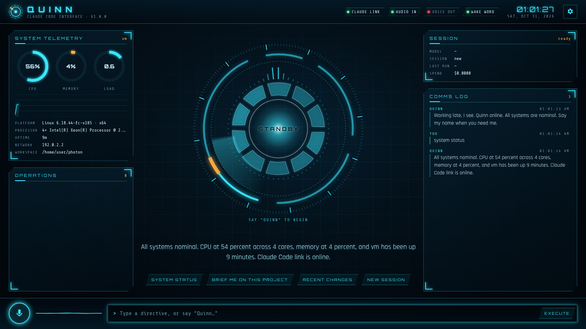

# QUINN

<p align="center"></p>

Quinn is a voice-controlled, Iron Man–style HUD for Claude Code. You talk to it (or type), it hands the request to the `claude` CLI on your machine, shows Claude's work as it happens, and reads the answer back to you.

- **Voice control:** say “Quinn, …” at any time, or click the mic / hold <kbd>Space</kbd> to talk without the wake word.
- **Spoken replies:** Quinn speaks the short opening of each answer and shows the full reply in the Comms Log.
- **Live operations:** every tool Claude Code runs (Bash, Read, Edit, …) appears in the Operations panel.
- **Telemetry:** CPU, memory, load, uptime, network and the workspace folder, refreshed every 3 seconds.
- **Memory between requests:** each request continues the same Claude Code session until you say “new session”.
- **No dependencies:** Node.js 18+ and the Claude Code CLI are all it needs.

## Run it

```sh
cd /path/to/your/project          # the folder Claude Code should work in
node /path/to/quinn/server.js
```

Open **http://localhost:7777** in Chrome or Edge, click **Engage** and allow the microphone. (Firefox and Safari can use Quinn by typing, but don't offer the speech recognition Quinn needs for voice.)

## Voice commands

| Say | What happens |
| --- | --- |
| “Quinn, *anything*” | Sent to Claude Code |
| “Quinn” (then pause) | Quinn answers “Yes?” and waits for your request |
| “Quinn, stop” | Aborts the current request and stops talking |
| “Quinn, system status” | Spoken telemetry report |
| “Quinn, what time is it” / “what's the date” | Answered locally |
| “Quinn, new session” | Starts a fresh Claude Code conversation |
| “Quinn, clear screen” | Clears the logs |
| “Quinn, mute” / “unmute” | Turns spoken replies off or on |
| “Quinn, go to sleep” | Stops listening for the wake word (click the mic to wake it) |

Keys: hold <kbd>Space</kbd> to talk (when you're not in the text box), <kbd>Esc</kbd> to abort. The gear icon opens settings for the voice, speech rate, pitch, wake word, spoken replies and interface sounds.

## Options

Set these as environment variables before starting the server.

| Variable | Default | Meaning |
| --- | --- | --- |
| `QUINN_PORT` | `7777` | Port for the interface |
| `QUINN_CWD` | current folder | Folder Claude Code works in |
| `QUINN_PERMISSION_MODE` | `default` | Claude Code permission mode: `default`, `acceptEdits`, `plan`, `bypassPermissions` … |
| `QUINN_MODEL` | Claude Code's default | Model to use, e.g. `opus` or `sonnet` |
| `QUINN_CLAUDE_BIN` | `claude` | Path to the Claude Code CLI |

**About permissions:** Quinn runs Claude Code non-interactively, so there's nobody to answer a permission prompt. In `default` mode, Claude can read and search but any action that would normally ask (editing files, running most commands) is declined. To let Quinn make changes, use `QUINN_PERMISSION_MODE=acceptEdits`, or allow specific tools in your Claude Code settings (`.claude/settings.json`). Only use `bypassPermissions` in a folder you're happy for Claude to change freely.

## Security

- The server only listens on `127.0.0.1`, so other computers can't reach it.
- It only answers requests addressed to `localhost` / `127.0.0.1`, which blocks DNS-rebinding tricks.
- API calls need an `X-Quinn` header that browsers won't send from other websites without a CORS approval Quinn never gives, so a web page you visit can't drive Claude Code through Quinn.

## Files

- `server.js`: serves the interface, reports telemetry and runs `claude -p --output-format stream-json`, streaming its events to the browser.
- `public/index.html`, `public/quinn.css`, `public/quinn.js`: the HUD, the arc-reactor visualiser, speech recognition and speech synthesis.

The fonts (Orbitron, Rajdhani, Share Tech Mono) load from Google Fonts; without internet Quinn falls back to system fonts.
